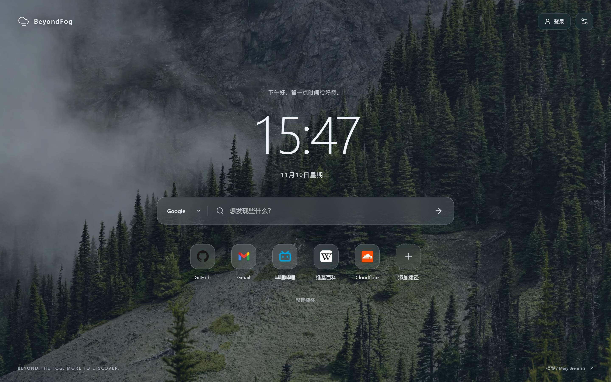
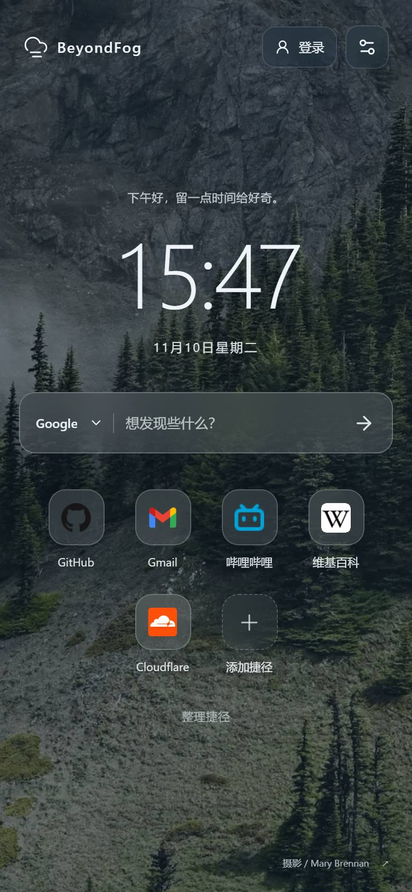

# BeyondFog

轻量、优雅的个人搜索起始页：云雾山林背景、大号时钟、可切换搜索引擎，快捷导航支持文件夹、拖动排序与跨设备同步。



<table>
  <tr>
    <td></td>
    <td valign="top">
      <h3>它做什么</h3>
      <p>一个私有首页：打开新标签就能看到今天的进度感——时间、一句雾景文案、搜索框，以及自己整理的网站。</p>
      <p>数据存在自己的 Cloudflare 账号里（D1 + Durable Object），同步冲突会保留本地编辑，不会静默覆盖。</p>
    </td>
  </tr>
</table>

> 截图来自 `feat/ui-modernize` 分支（尚未合并到 `main`）；线上当前仍是上一版界面。

## 特性

- **雾景首页**：三张内置雾景壁纸（可换暗度），也可以用 WebDAV 上的私人图片，服务端流式代理、限 20 MiB。
- **搜索框**：Google / 必应 / 百度 随时切换，新标签或当前页打开可配置。
- **快捷导航**：平铺或文件夹两种布局；拖动排序；超过三行自动收起，点「展开全部」再看全部。
- **文件夹弹层**：悬停、点击、键盘都能用；手机端自动变成底部抽屉，名称过长自动换行不截断。
- **设置中心**：外观、捷径、网盘、账号四个模块；支持按名称或域名搜索已有站点、批量导入 6 类共 19 个站点预设、上下移动与归属切换。
- **跨设备同步**：版本号 CAS 保存；另一台设备改过会提示冲突并保留本地编辑；首帧用本地快照直接画出布局，不会先闪一段默认内容。
- **安全**：单管理员账号、会话 Cookie、登录与重置限流、WebDAV 域名白名单、严格 CSP 与 HSTS。

## 技术栈

React 19 + TypeScript + Vite（无 UI 框架，手写 CSS 变量与玻璃质感）· Cloudflare Workers 原生 fetch 入口 · SQLite Durable Object + D1 · Better Auth 原生 D1 适配 · zod 前后端共享 schema · fast-xml-parser 解析 WebDAV。

## 本地运行

需要 Node.js 24+（`package.json` 已声明 `engines`，单元测试直接使用 `node:sqlite`）。先运行：

```powershell
npm ci
npm run setup:local
npm run db:local
node scripts/seed-test.mjs
npm run dev
```

打开 http://127.0.0.1:5173 。本地测试邮箱 `owner@example.com`，测试密码 `BeyondFog-test-password-2026`。`seed-test.mjs` **只访问本地 D1**，会重建这一测试账号及其测试配置；线上账号由独立交互脚本创建。不要在 `.dev.vars` 使用线上密钥。`.dev.vars`、构建目录、日志、浏览器截图和测试附件不提交。

也可自行创建本地账号：修改 `.dev.vars` 的 OWNER_EMAIL，执行 `npm run account:create -- --local`。脚本隐藏密码输入，邮箱须匹配配置。

```powershell
npm run typecheck
npm test
npx playwright install chromium
npm run test:e2e
npm run build
```

`npm run test:e2e` 会复用已运行的 `npm run dev`；如果没有，请先执行 `npm run db:local` 与 `node scripts/seed-test.mjs`，否则登录用例会失败。

测试包括真实 SQLite 上的 Better Auth 原生 D1 协议、真实本地 Worker/D1/DO、两个独立浏览器的配置同步和 CAS 冲突，以及超限/非法路径/重置链接/会话/流式上传。外部网盘在单元测试中替换为受控 HTTPS 响应；真实网盘仍需联调。

## 项目结构

```
worker/           Worker 入口、认证、限流、安全头、WebDAV
src/              首页、设置中心、同步状态机、共享 schema 与样式
migrations/       D1 初始结构与索引
tests/            unit（vitest）与 e2e（Playwright）
docs/             计划、进度、部署、素材与标签方案
```

## 文档

- 部署、账号引导、免费资源限额、邮件、WebDAV 白名单与回滚：[docs/DEPLOYMENT.md](docs/DEPLOYMENT.md)
- 已批准规格：[docs/PLAN.md](docs/PLAN.md)
- 实施与测试记录：[docs/PROGRESS.md](docs/PROGRESS.md)
- 素材许可：[docs/ASSETS.md](docs/ASSETS.md)
